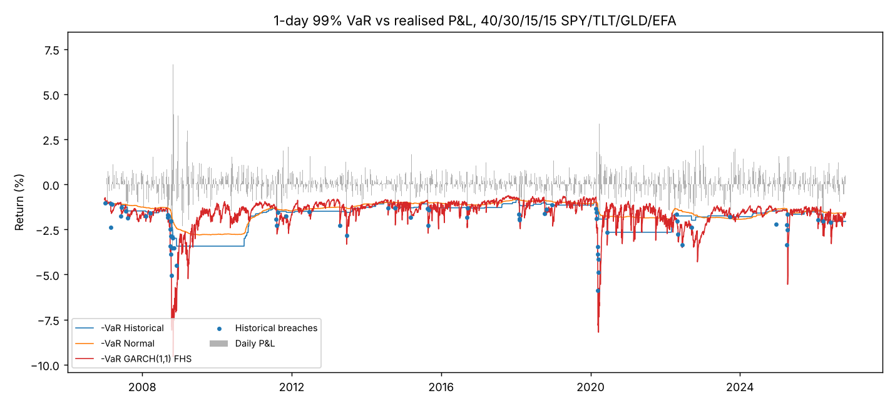
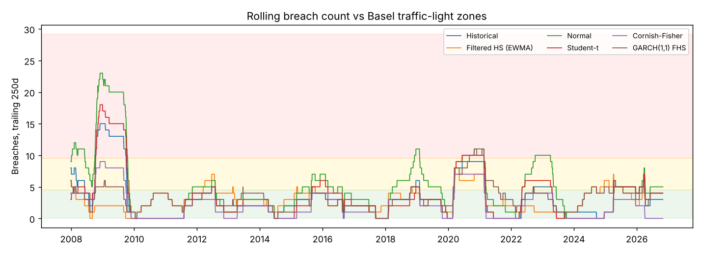

# var-es-risk

Value-at-Risk and Expected Shortfall from first principles: six models, four backtests and a
20-year walk-forward study on a multi-asset portfolio.

[](https://github.com/Tmr49/var-es-risk/actions/workflows/ci.yml)

## Headline result

1-day 99% VaR/ES, 500-day rolling window, re-estimated daily, on a daily-rebalanced
40/30/15/15 SPY/TLT/GLD/EFA portfolio (Jan 2007 – Oct 2026, 4,991 forecasts; about 50 breaches
expected).

| Model              | Breaches | Rate  | Kupiec p | Christoffersen ind. p | Basel zone (last 250d) | Acerbi–Székely Z₂ |
|:-------------------|---------:|------:|---------:|----------------------:|:-----------------------|------------------:|
| Historical         |       67 | 1.34% |    0.021 |                <0.001 | green                  |            −0.49 |
| Filtered HS (EWMA) |       61 | 1.22% |    0.127 |                 0.001 | green                  |            −0.26 |
| Normal             |       97 | 1.94% |   <0.001 |                <0.001 | yellow                 |            −1.65 |
| Student-t          |       66 | 1.32% |    0.029 |                <0.001 | green                  |            −0.43 |
| Cornish–Fisher     |       42 | 0.84% |    0.247 |                <0.001 | green                  |            +0.07 |
| GARCH(1,1) FHS     |       69 | 1.38% |    0.010 |                 0.003 | green                  |            −0.41 |

Z₂ has expectation 0 under a correct ES model; values below about −0.7 reject at 5%
(Acerbi & Székely, 2014).




### What the numbers say

* **Normal VaR fails decisively.** About twice the expected breach count, and its ES is the only
  one rejected by Z₂. Fat tails are real in daily returns.
* **Unconditional coverage isn't enough.** Every model fails Christoffersen's independence
  test. Breaches cluster in 2008, March 2020, 2022 and April 2025 because a 500-day window
  reacts slowly to regime changes. Plain historical VaR is a step function that jumps *after*
  the crisis and stays high for two years after it's over.
* **Volatility conditioning helps the most.** EWMA-filtered HS gives the best combination of
  coverage and the least clustering, and it stays in the green zone right through 2008–09
  while plain HS, Normal and Student-t go deep into red. GARCH FHS tracks volatility just as closely but slightly under-covers here.
* **Cornish–Fisher passes on coverage but is conservative.** It sees skew/kurtosis from the
  2008 window and keeps VaR high. It also isn't guaranteed to be monotone for large moments,
  so it would be a poor choice in a production limit framework.
* **Student-t needs care.** The MLE degrees of freedom sometimes hits ν ≈ 2. Rescaling the
  standard t by the sample standard deviation then collapses VaR towards zero. The fix
  (see `fit_and_estimate`) uses the MLE location/scale directly, and a regression test locks
  it in.

## Models

All functions return a `RiskEstimate(var, es, alpha, horizon)` with VaR and ES as positive
losses, as a fraction of portfolio value.

| Function | Method |
|---|---|
| `historical_var_es` | Empirical loss quantile; ES = mean loss beyond VaR |
| `filtered_historical_var_es` | Hull–White / Barone-Adesi: EWMA (λ = 0.94) devolatilised residuals rescaled to tomorrow's vol |
| `normal_var_es` | VaR = −μ + σ z_α, ES = −μ + σ φ(z_α)/(1−α) |
| `student_t_var_es` | Variance-matched t: ES = −μ + s · f_ν(q)/(1−α) · (ν + q²)/(ν − 1) |
| `cornish_fisher_var_es` | Skew/kurtosis-adjusted quantile; ES integrates the CF quantile over the tail |
| `mc_portfolio_var_es` | Multivariate Normal or t simulation via Cholesky, multi-day horizons by summing daily draws |
| `fit_garch11`, `garch_mc_var_es` | Gaussian QMLE GARCH(1,1); horizon paths with bootstrapped standardised residuals |

## Backtests

| Function | Null hypothesis |
|---|---|
| `kupiec_pof` | Breach rate equals 1 − α (LR ~ χ²₁) |
| `christoffersen_independence` | Breaches follow no first-order Markov dependence (LR ~ χ²₁) |
| `christoffersen_cc` | Correct coverage *and* independence (LR ~ χ²₂) |
| `basel_traffic_light` | Basel zones from the binomial CDF (250 days at 99%: green 0–4, yellow 5–9, red 10+) |
| `acerbi_szekely_z2` | ES correctly specified given VaR (E[Z₂] = 0) |

## Usage

```python
import pandas as pd
import var_es as ve

px = pd.read_csv("data/prices.csv", index_col=0, parse_dates=True)
r = px.pct_change().dropna() @ [0.4, 0.3, 0.15, 0.15]

ve.filtered_historical_var_es(r, alpha=0.99)
ve.mc_portfolio_var_es(
    px.pct_change().dropna(),
    [0.4, 0.3, 0.15, 0.15],
    alpha=0.975,
    horizon=10,
    dist="t",
    nu=5,
    seed=0,
)

bt = ve.rolling_backtest(r, lambda w: ve.historical_var_es(w, 0.99), window=500)
ve.summarize(bt, 0.99)
```

## Reproduce

```bash
pip install -e ".[dev]"
pytest                          # 24 tests, including closed-form and simulation checks
python scripts/run_backtest.py  # about 5 min; writes results/
python scripts/fetch_data.py    # optional: refresh data/prices.csv (needs yfinance)
```

Prices are adjusted closes from Yahoo Finance, cached in `data/prices.csv` so results
reproduce offline.

## Limitations and next steps

* Daily rebalancing at constant weights; no transaction costs or intraday risk.
* Square-root-of-time scaling for multi-day HS/parametric VaR ignores volatility clustering
  (`garch_mc_var_es` addresses this).
* Next: simulated p-values for Z₂, EVT (POT/GPD) tail model, component/incremental VaR, and
  stressed VaR on the 2008 window as in FRTB.

## References

* Kupiec (1995), *Techniques for verifying the accuracy of risk measurement models*.
* Christoffersen (1998), *Evaluating interval forecasts*.
* Acerbi & Székely (2014), *Backtesting Expected Shortfall*.
* Barone-Adesi, Giannopoulos & Vosper (1999), *VaR without correlations for portfolios of
  derivative securities*.
* Basel Committee (1996), *Supervisory framework for the use of backtesting*.
