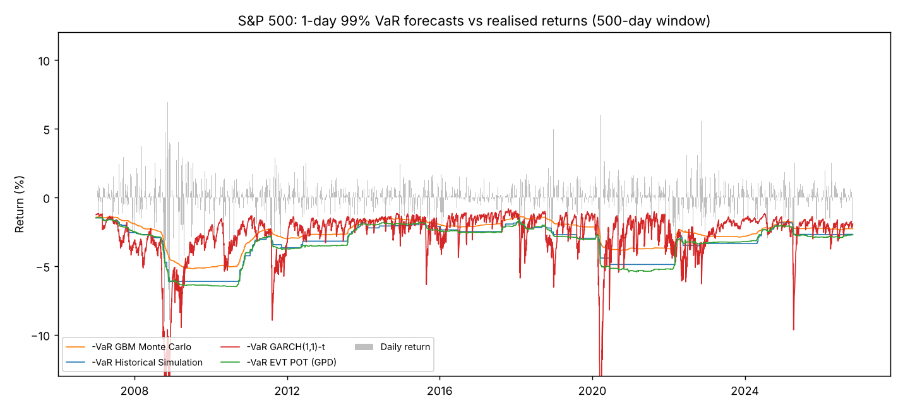
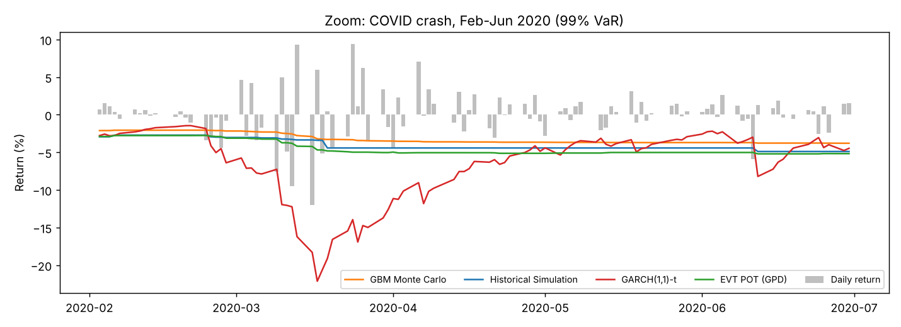

# var-es-risk

A rolling-window backtesting framework in Python that compares four tail-risk models on
S&P 500 daily returns from 2005 to 2026:

1. **GBM Monte Carlo**, a constant-volatility, light-tailed benchmark
2. **Historical Simulation**, which makes no distributional assumption
3. **GARCH(1,1)-t**, with conditional volatility and Student-t innovations
4. **EVT Peaks-over-Threshold**, which fits a Generalised Pareto tail

Each trading day, every model is fitted on the previous 500 daily returns. It forecasts the
next day's Value-at-Risk (VaR) and Expected Shortfall (ES), and the forecast is compared with
what actually happened.

[](https://github.com/Tmr49/var-es-risk/actions/workflows/ci.yml)

## Results

There are 4,991 out-of-sample forecasts, from January 2007 to October 2026.

**99% 1-day VaR** (about 50 breaches expected)

| Model                 | Breaches | Rate  | Kupiec p | Christoffersen ind. p | Loss / ES on breach |
|:----------------------|---------:|------:|---------:|----------------------:|--------------------:|
| GBM Monte Carlo       |      143 | 2.87% |   <0.001 |                <0.001 |                1.31 |
| Historical Simulation |       83 | 1.66% |   <0.001 |                <0.001 |                1.10 |
| GARCH(1,1)-t          |       81 | 1.62% |   <0.001 |             **0.199** |            **1.03** |
| EVT POT (GPD)         |       83 | 1.66% |   <0.001 |                <0.001 |                1.12 |

**97.5% 1-day VaR** (about 125 breaches expected)

| Model                 | Breaches | Rate  | Kupiec p | Christoffersen ind. p | Loss / ES on breach |
|:----------------------|---------:|------:|---------:|----------------------:|--------------------:|
| GBM Monte Carlo       |      218 | 4.37% |   <0.001 |                <0.001 |                1.30 |
| Historical Simulation |      167 | 3.35% |   <0.001 |                <0.001 |                1.10 |
| GARCH(1,1)-t          |      198 | 3.97% |   <0.001 |             **0.757** |            **1.02** |
| EVT POT (GPD)         |      161 | 3.23% |    0.002 |                <0.001 |                1.10 |

"Loss / ES on breach" is the average realised loss on breach days divided by the forecast
ES. It should be close to 1 if ES is right, and values above 1 mean the model understates
how bad breach days are.





### What the results show

* **GBM fails badly.** It breaches nearly three times as often as it should. When it does
  breach, losses average 31% more than its ES. S&P 500 daily returns have an excess kurtosis
  of about 13, and a normal model can't capture that.
* **Historical Simulation and EVT are similar on coverage but react late.** They breach at
  about the same rate. Both rely on a fixed 500-day window, so they stay calm going into a
  crisis, breach repeatedly (2008: 21 and 20 breaches), then stay too conservative for two
  years after it ends. That's why both fail Christoffersen's independence test. EVT's
  advantage is in the tail *shape*. Its ES comes from a fitted GPD (full-sample ξ ≈ 0.18, a
  power-law tail) rather than the handful of observations beyond VaR.
* **GARCH(1,1)-t is the only model whose breaches don't cluster** (independence p = 0.20 at
  99%, 0.76 at 97.5%). It also has the most accurate ES. It reacts within days: in March
  2020 its VaR went from about 2% to over 20%, while the window-based models barely moved
  (see the COVID zoom). The cost is that it under-covers in calm periods. Vol persistence
  (α + β ≈ 0.99) makes it pull VaR down quickly once markets settle, so breaches are spread
  across quiet years rather than bunched in crises.
* **No model passes Kupiec at 99%.** About 1.6% is the best breach rate, against the 1%
  target. Any 500-day calibration struggles across 2008, 2020 and 2022. The obvious next
  step is to combine the two ideas that work: GARCH filtering for timing and an EVT tail for
  shape (McNeil & Frey, 2000).

## Models

Every function returns a `RiskEstimate(var, es, alpha, horizon)`, with VaR and ES as
positive losses expressed as a fraction of portfolio value.

| Function | Method |
|---|---|
| `gbm_mc_var_es` | Fit μ and σ from log returns, simulate S_T/S_0 = exp((μ − σ²/2)T + σ√T Z), and read off VaR/ES |
| `historical_var_es` | Empirical loss quantile; ES is the mean loss beyond VaR |
| `fit_garch_t`, `garch_t_var_es` | MLE for GARCH(1,1) with unit-variance t innovations. 1-day VaR/ES comes from the conditional t in closed form; multi-day horizons simulate GARCH paths |
| `fit_pot`, `evt_pot_var_es` | Fit a GPD to losses above the 90th percentile. VaR = u + β/ξ[((n/N_u)(1−α))^(−ξ) − 1], ES = (VaR + β − ξu)/(1 − ξ) |

## Backtests

| Function | Null hypothesis |
|---|---|
| `kupiec_pof` | The breach rate equals 1 − α (LR ~ χ²₁) |
| `christoffersen_independence` | Today's breach doesn't depend on yesterday's (LR ~ χ²₁) |
| `christoffersen_cc` | Correct coverage *and* independence (LR ~ χ²₂) |
| `rolling_backtest`, `summarize` | Walk-forward engine and summary table |

## Usage

```python
import pandas as pd
import var_es as ve

r = pd.read_csv("data/sp500.csv", index_col=0, parse_dates=True)["close"].pct_change().dropna()

ve.evt_pot_var_es(r, alpha=0.99)
ve.garch_t_var_es(r, alpha=0.99, horizon=10, seed=0)

bt = ve.rolling_backtest(r, lambda w: ve.historical_var_es(w, 0.99), window=500)
ve.summarize(bt, 0.99)
```

## Reproduce

```bash
pip install -e ".[dev]"
pytest                          # closed-form, simulation and parameter-recovery tests
python scripts/run_backtest.py  # about 4 minutes; writes results/
python scripts/fetch_data.py    # optional: refresh data/sp500.csv (pip install yfinance)
```

The data is S&P 500 index (^GSPC) closes from Yahoo Finance, cached in `data/sp500.csv` so
results reproduce offline. GARCH parameters are re-estimated every 20 trading days, and the
variance is filtered daily.

## Limitations

* The 500-day window and the 90% EVT threshold are fixed, not tuned. Results are sensitive
  to both.
* Multi-day VaR for HS and EVT uses square-root-of-time scaling.
* Price returns only: dividends are excluded.

## References

* McNeil & Frey (2000), *Estimation of tail-related risk measures for heteroscedastic
  financial time series: an extreme value approach*.
* McNeil, Frey & Embrechts, *Quantitative Risk Management*.
* Kupiec (1995), *Techniques for verifying the accuracy of risk measurement models*.
* Christoffersen (1998), *Evaluating interval forecasts*.
* Bollerslev (1987), *A conditionally heteroskedastic time series model for speculative
  prices and rates of return*.
